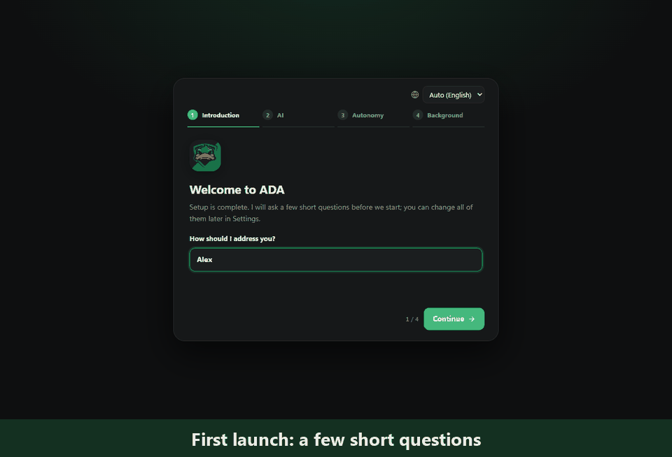
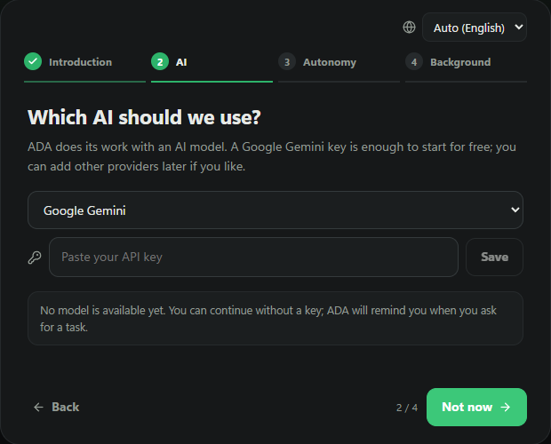
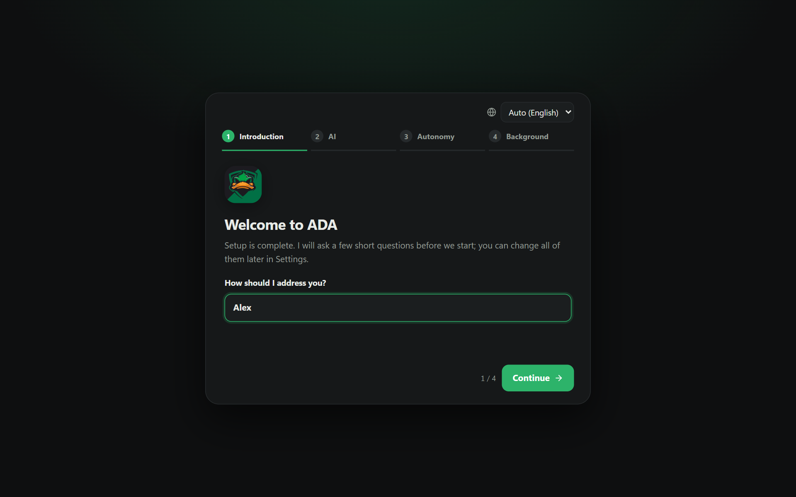
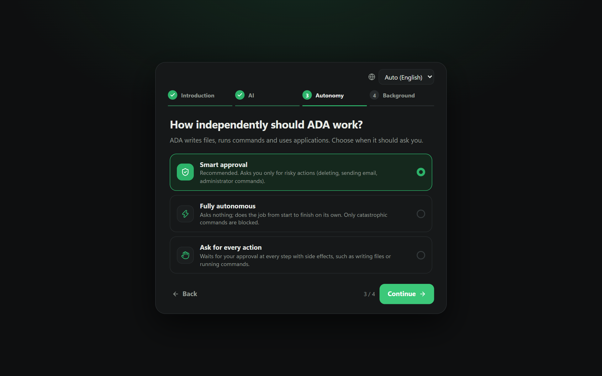
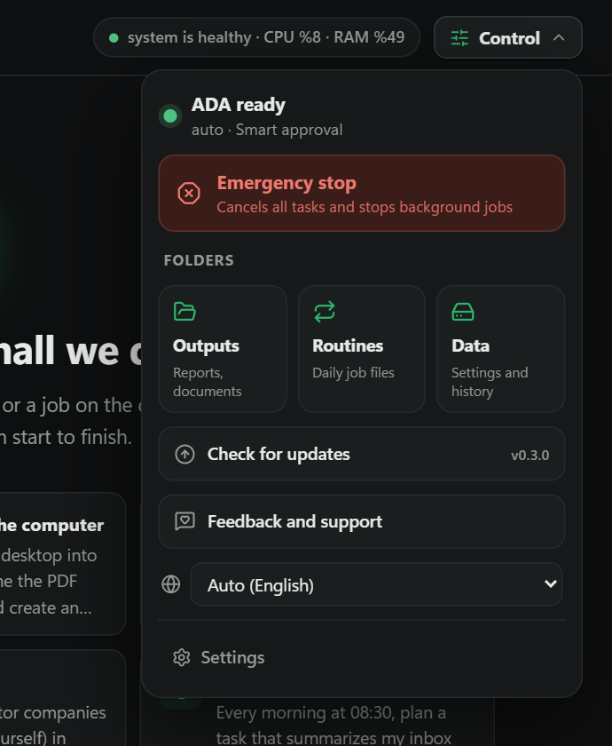
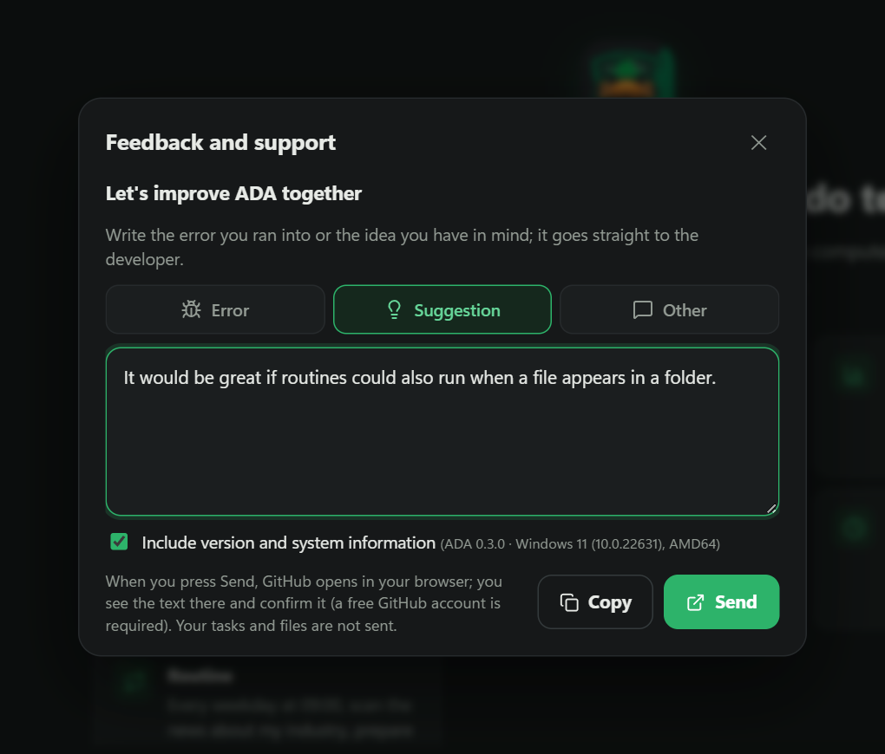
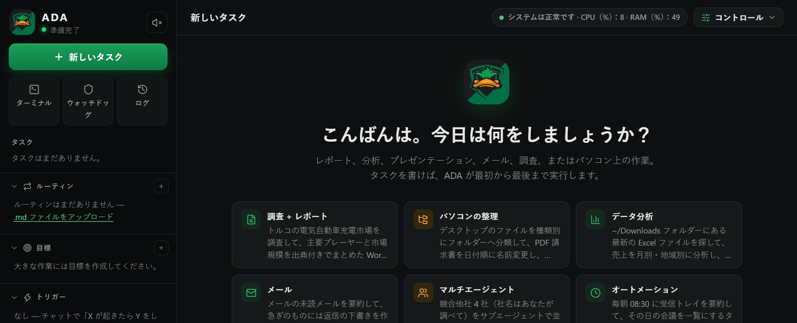
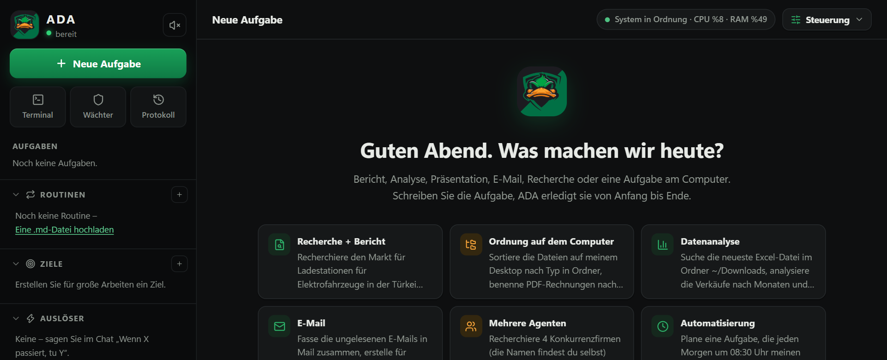
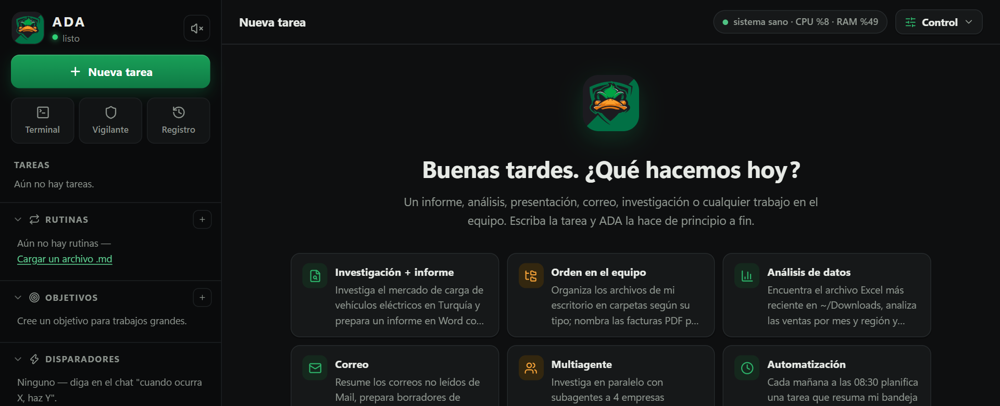

# ADA

[English](README.md) · **Türkçe**

ADA, bilgisayarınızda çalışan otonom bir yapay zekâ çalışanıdır: rapor, analiz, sunum, e-posta, araştırma ve bilgisayardaki işleri görevi yazdığınızda baştan sona kendisi yapar.

<p align="center"></p>

## İndir

**[ADA'yı Windows için indir](https://github.com/Guardscloud/ADA/releases/latest/download/ADA-Setup.exe)** · macOS: [tüm sürümler](https://github.com/Guardscloud/ADA/releases) · Site: [guardscloud.github.io/ADA](https://guardscloud.github.io/ADA/)

- Windows 10 / 11 (64 bit) · macOS (Apple Silicon ve Intel)
- Ücretsiz.
- Yönetici izni gerekmez; yalnızca sizin kullanıcınız için kurulur.
- İlk açılışta birkaç kısa soru sorar (ad, yapay zekâ anahtarı, özerklik, arka plan seçenekleri).


## Başlarken

**1. Kurun.** `ADA-Setup.exe` dosyasını indirip çalıştırın. Windows **"Windows bilgisayarınızı korudu"** uyarısını gösterirse **Ek bilgi**'ye, ardından **Yine de çalıştır**'a tıklayın. Uyarının nedeni, ADA'nın Windows'un tanıdığı ücretli bir sertifika yerine kendi sertifikamızla imzalı olmasıdır. İndirdiğiniz dosyayı denetleyebilmeniz için GitHub her sürüm dosyasının SHA-256 özetini gösterir.

**2. Yapay zekâ anahtarı ekleyin (ücretsiz).** ADA'nın çalışması için bir yapay zekâ modeli gerekir. En hızlı ücretsiz seçenek Google Gemini:

1. [aistudio.google.com/apikey](https://aistudio.google.com/apikey) adresini açıp Google hesabınızla giriş yapın.
2. **Create API key**, ardından **Copy**'ye tıklayın.
3. ADA'nın kurulum ekranındaki anahtar alanına yapıştırıp **Kaydet**'e basın. ADA anahtarı doğrular ve kullanılabilir modelleri listeler.

<p align="center"></p>

Anahtar yok mu? ADA yerel modellerle de çalışır: [Ollama](https://ollama.com)'yı kurup bir model indirin, ADA kendisi bulur. Diğer sağlayıcıları (Claude, OpenAI, Groq ve diğerleri) sonradan **Ayarlar → Yapay zekâ** bölümünden ekleyebilirsiniz.

**3. Bir iş verin.** İhtiyacınızı düz cümleyle yazın, örneğin:

- *"Elektrikli araç şarj pazarını araştır, kaynaklı bir Word raporu yaz."*
- *"Masaüstümdeki dosyaları türlerine göre klasörlere ayır."*
- *"Her hafta içi 09:00'da sektörümle ilgili haberleri özetle."*

## Neler yapar?

- **Görevler:** Yazdığınız işi adım adım yapar; Word, Excel, PDF ve sunum dosyaları üretir.
- **Rutinler:** Her gün kendiliğinden yapılacak işleri düz Markdown dosyalarıyla tanımlarsınız.
- **Birden çok yapay zekâ:** Bu bilgisayardaki yerel modelleri (Ollama, LM Studio ve diğerleri) ve anahtarını girdiğiniz bulut modellerini (Gemini, Claude, OpenAI ve diğerleri) kullanır; işi türüne göre en uygun modele verir. Bir model sınıra takılırsa iş sıradakiyle sürer. İsterseniz her mesajda modeli gönder düğmesinin yanından kendiniz seçersiniz.
- **Gözcü:** Disk, bellek, işlemci ve internet durumunu izler, sorun olursa haber verir.
- **Kontrol sizde:** Ne zaman size soracağını siz seçersiniz; tek tuşla acil durdurma vardır.
- **Tor (isteğe bağlı):** İlk açılışta ADA, web aramalarını ve sayfa okumayı Tor ağı üzerinden yaparak IP adresinizi sitelerden gizlemeyi önerir. Siz kabul etmedikçe hiçbir şey indirilmez.
- **Güvenlik modu:** Bilgisayarı kapatabilecek ya da diski silebilecek komutlar güvenli modda asla çalışmaz; *onayla her şey* moduna geçerseniz ADA her seferinde size sorar.

| İlk açılış soruları | ADA'nın ne kadar bağımsız çalışacağını siz seçersiniz |
|---|---|
|  |  |

| Kontrol menüsü | Uygulama içinden geri bildirim |
|---|---|
|  |  |

ADA yalnızca sizin bilgisayarınızda çalışır. API anahtarlarınız ve verileriniz bilgisayarınızda kalır; yalnızca seçtiğiniz yapay zekâ sağlayıcısına görev için gereken içerik gönderilir.

## Diller

Arayüz English, Türkçe, Deutsch, Français, Español, Português, Italiano, Русский, 中文 ve 日本語 dillerinde kullanılabilir. ADA sistem dilinizi izler; **Kontrol → dil** seçicisinden istediğiniz zaman değiştirebilirsiniz. ADA size hangi dilde yazarsanız o dilde yanıt verir.

Görevlerinizi ve rutin dosyalarınızı da istediğiniz dilde yazabilirsiniz: ADA isteği yazıldığı dilde anlar, raporlarını ve belgelerini o dilde üretir.

<p align="center">
  
  
  
</p>

Çeviriler makineyle üretilmiştir; düzeltmeler memnuniyetle karşılanır.

## Güncellemeler

ADA yeni sürümleri kendisi denetler. Yeni sürüm çıktığında bildirim gösterir; **Kontrol → Güncelle** ile tek tıkla kurulur, ayarlarınız ve verileriniz korunur.

## Geri bildirim

Bir hata bulduysanız ya da bir fikriniz varsa:

- Uygulama içinden: **Kontrol → Geri bildirim ve destek**
- Ya da doğrudan buradan: [yeni kayıt aç](https://github.com/Guardscloud/ADA/issues/new/choose)

Her geri bildirim okunur ve ADA'nın geliştirilmesinde kullanılır.

## Kaynak kod ve lisans

ADA ücretsizdir. Kaynak kodu **0.5.0 sürümüne kadar açıktır**: bu depodaki kod o sürümdür ve [MIT lisansıyla](LICENSE) okunabilir, değiştirilebilir, yeniden kullanılabilir. 0.5.1'den itibaren uygulamanın çekirdeği kapalı bir depoda geliştirilir; yeni sürümler ücretsizdir ama açık kaynak değildir. [Open Kernel](docs/KERNEL.md) eklenti arayüzü açık ve destekli kalır.

Açık 0.5.0 kodunu kaynaktan çalıştırmak için [uv](https://docs.astral.sh/uv/) ve Node 18+ gerekir:

```powershell
uv sync
cd frontend; npm install; npm run build; cd ..
uv run pytest -q        # testler
uv run ada-app          # masaüstü penceresi  (yalnızca tarayıcı için: uv run ada)
```

Mimari, ayarlar ve geliştirme notları: [docs/GELISTIRICI.md](docs/GELISTIRICI.md). Katkılar için bir kayıt açın ya da doğrudan değişiklik isteği (pull request) gönderin.

"ADA" adı ve Duck Team ördek logosu proje sahibine aittir; MIT lisansı bu depodaki kodu kapsar, adı ve logoyu kapsamaz.
