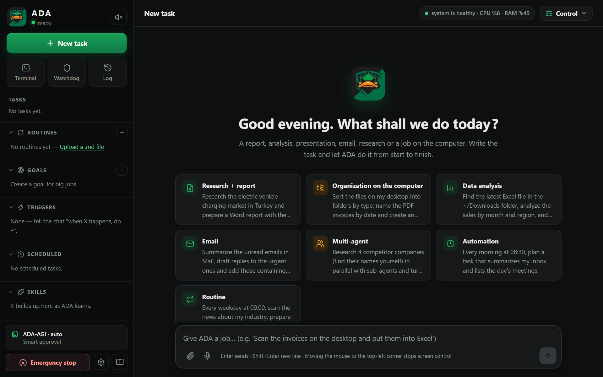

# ADA

[English](README.md) · **Türkçe**

ADA, bilgisayarınızda çalışan otonom bir yapay zekâ çalışanıdır: rapor, analiz, sunum, e-posta, araştırma ve bilgisayardaki işleri görevi yazdığınızda baştan sona kendisi yapar.

<p align="center"></p>

## İndir

**[ADA'yı Windows için indir](https://github.com/Guardscloud/ADA/releases/latest/download/ADA-Setup.exe)** · [tüm sürümler](https://github.com/Guardscloud/ADA/releases)

- Windows 10 / 11 (64 bit)
- Yönetici izni gerekmez; yalnızca sizin kullanıcınız için kurulur.
- İlk açılışta birkaç kısa soru sorar (ad, yapay zekâ anahtarı, özerklik, arka plan seçenekleri).

> **Windows uyarısı:** ADA kendi sertifikamızla imzalıdır, ancak bu sertifika Windows tarafından henüz tanınmadığı için ilk çalıştırmada "Windows bilgisayarınızı korudu" uyarısı çıkabilir. **Ek bilgi → Yine de çalıştır** ile devam edebilirsiniz.

## Neler yapar?

- **Görevler:** Yazdığınız işi adım adım yapar; Word, Excel, PDF ve sunum dosyaları üretir.
- **Rutinler:** Her gün kendiliğinden yapılacak işleri düz Markdown dosyalarıyla tanımlarsınız.
- **Birden çok yapay zekâ:** Bu bilgisayardaki yerel modelleri (Ollama, LM Studio ve diğerleri) ve anahtarını girdiğiniz bulut modellerini (Gemini, Claude, OpenAI ve diğerleri) kullanır; işi türüne göre en uygun modele verir. Bir model sınıra takılırsa iş sıradakiyle sürer.
- **Gözcü:** Disk, bellek, işlemci ve internet durumunu izler, sorun olursa haber verir.
- **Kontrol sizde:** Ne zaman size soracağını siz seçersiniz; tek tuşla acil durdurma vardır.

| İlk açılış soruları | ADA'nın ne kadar bağımsız çalışacağını siz seçersiniz |
|---|---|
|  |  |

| Kontrol menüsü | Uygulama içinden geri bildirim |
|---|---|
|  |  |

ADA yalnızca sizin bilgisayarınızda çalışır. API anahtarlarınız ve verileriniz bilgisayarınızda kalır; yalnızca seçtiğiniz yapay zekâ sağlayıcısına görev için gereken içerik gönderilir.

## Diller

Arayüz English, Türkçe, Deutsch, Français, Español, Português, Italiano, Русский, 中文 ve 日本語 dillerinde kullanılabilir. ADA sistem dilinizi izler; **Kontrol → dil** seçicisinden istediğiniz zaman değiştirebilirsiniz. ADA size hangi dilde yazarsanız o dilde yanıt verir.

Görevlerinizi ve rutin dosyalarınızı da istediğiniz dilde yazabilirsiniz: ADA isteği yazıldığı dilde anlar, raporlarını ve belgelerini o dilde üretir.

<p align="center">
  
  
  
</p>

Çeviriler makineyle üretilmiştir; düzeltmeler memnuniyetle karşılanır.

## Güncellemeler

ADA yeni sürümleri kendisi denetler. Yeni sürüm çıktığında bildirim gösterir; **Kontrol → Güncelle** ile tek tıkla kurulur, ayarlarınız ve verileriniz korunur.

## Geri bildirim

Bir hata bulduysanız ya da bir fikriniz varsa:

- Uygulama içinden: **Kontrol → Geri bildirim ve destek**
- Ya da doğrudan buradan: [yeni kayıt aç](https://github.com/Guardscloud/ADA/issues/new/choose)

Her geri bildirim okunur ve ADA'nın geliştirilmesinde kullanılır.

## Açık kaynak

ADA açık kaynaklıdır ([MIT lisansı](LICENSE)). Kodu inceleyebilir, değiştirebilir ve katkıda bulunabilirsiniz.

Kaynaktan çalıştırmak için [uv](https://docs.astral.sh/uv/) ve Node 18+ gerekir:

```powershell
uv sync
cd frontend; npm install; npm run build; cd ..
uv run pytest -q        # testler
uv run ada-app          # masaüstü penceresi  (yalnızca tarayıcı için: uv run ada)
```

Mimari, ayarlar ve geliştirme notları: [docs/GELISTIRICI.md](docs/GELISTIRICI.md). Katkılar için bir kayıt açın ya da doğrudan değişiklik isteği (pull request) gönderin.

"ADA" adı ve Duck Team ördek logosu proje sahibine aittir; MIT lisansı kodu kapsar, adı ve logoyu kapsamaz.
